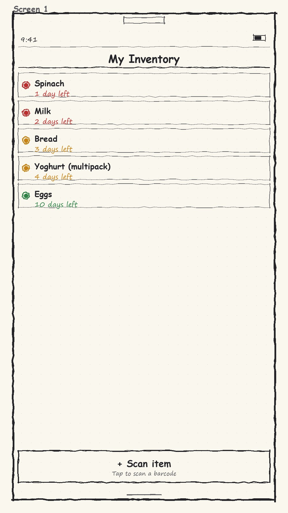
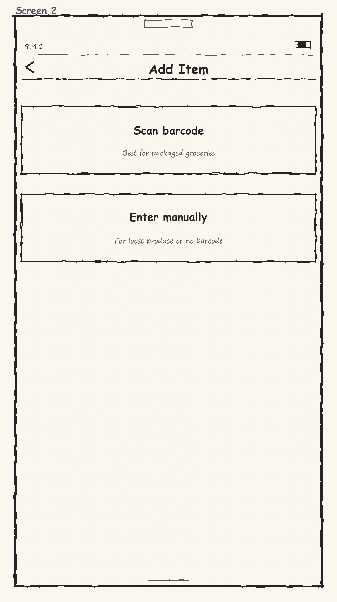
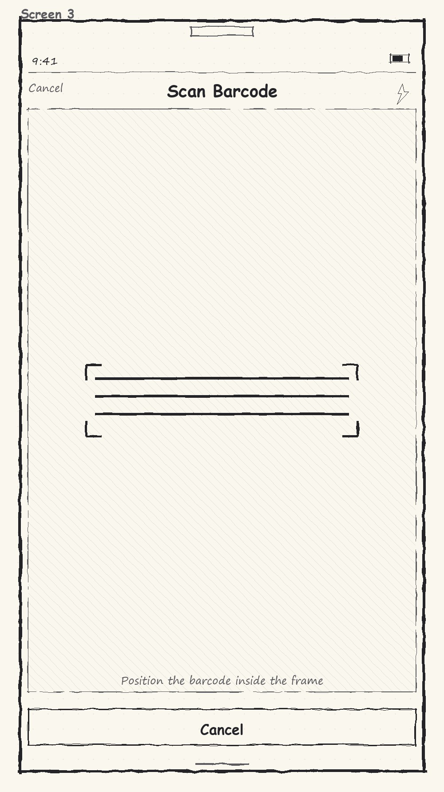
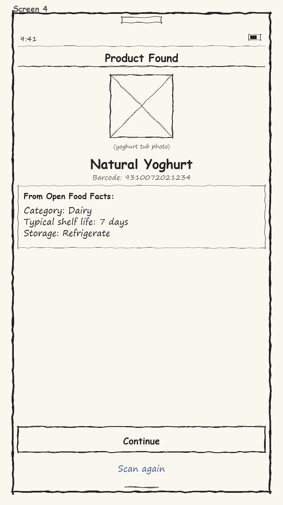
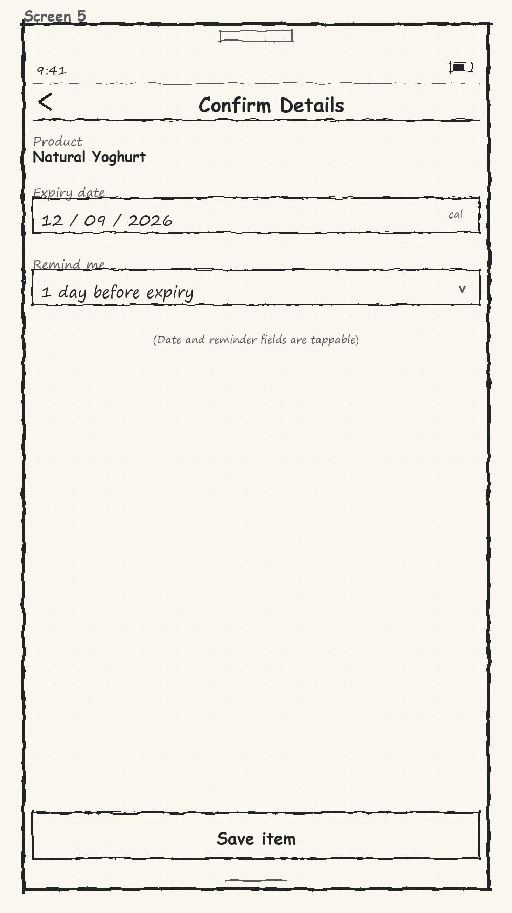
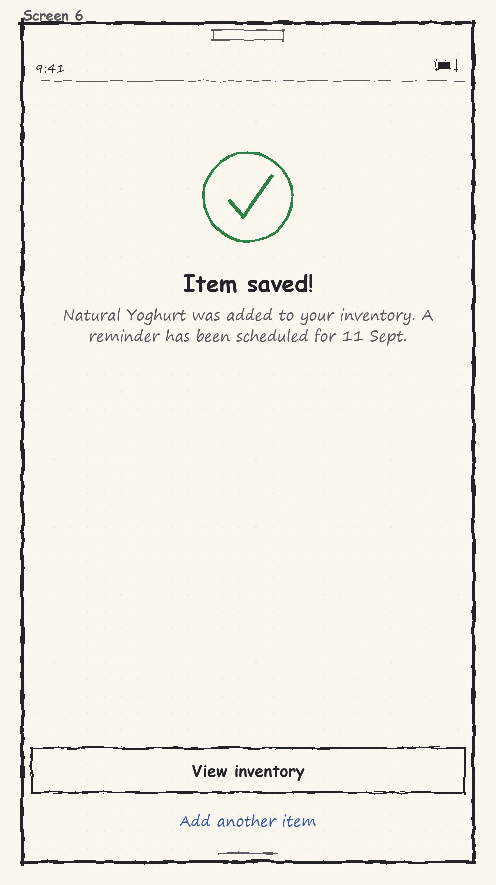
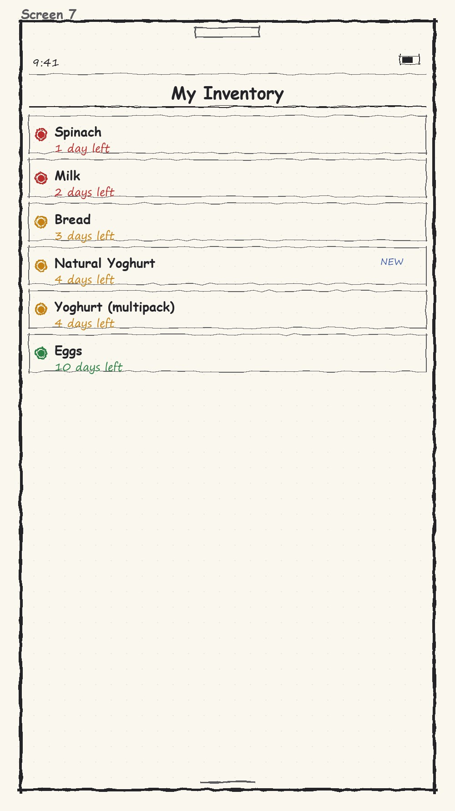
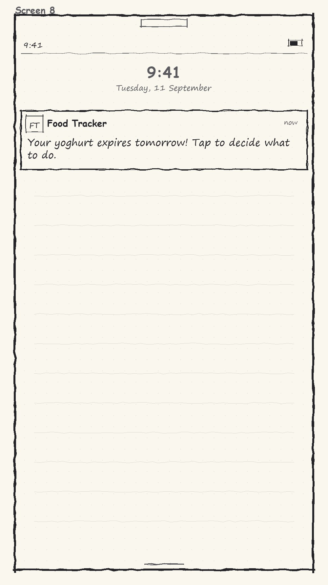
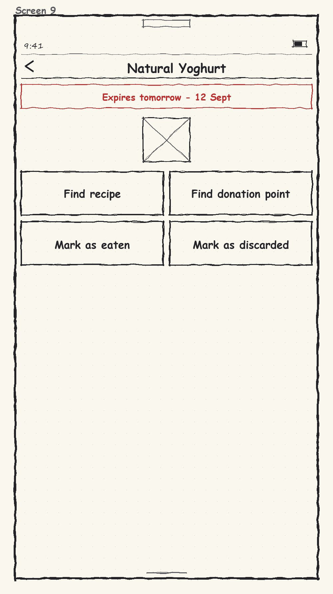
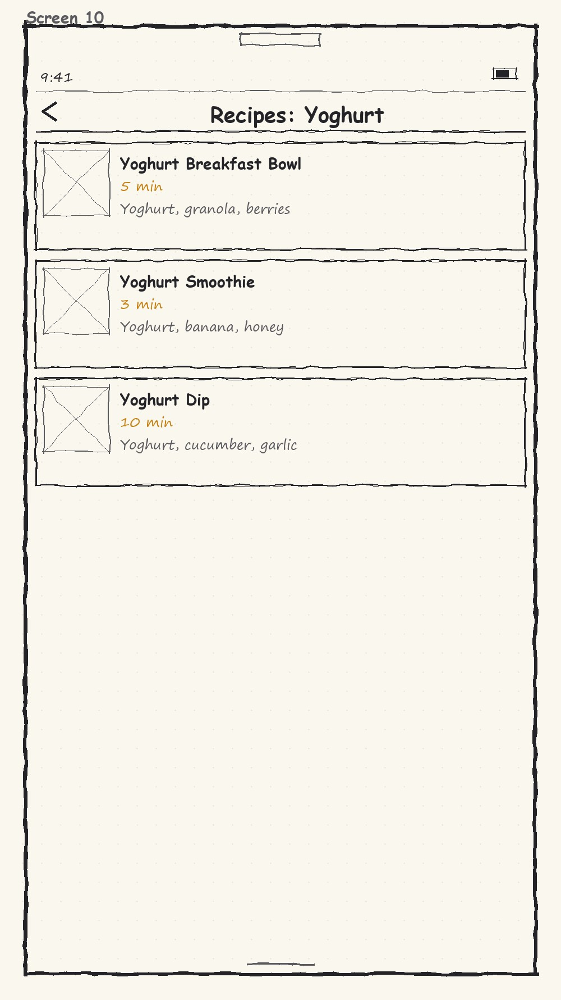

# Task 1b - Low-Fidelity Paper Prototype

## Prototype overview

The low-fidelity prototype demonstrates the Smart Food Expiry Tracker's main workflow: adding a grocery item with barcode scanning, confirming its expiry information, receiving an expiry warning, and finding a way to consume the item before it is wasted.

The prototype follows Priya, a university student who has purchased a tub of yoghurt. She scans the yoghurt, checks its details, saves it to her inventory, and later responds to an expiry reminder by finding a suitable recipe.

## Core workflow

**Inventory -> Add item -> Scan barcode -> Review product -> Confirm expiry -> Save item -> View inventory -> Receive reminder -> Open item -> Find recipe**

## Prototype screens

### Screen 1 - Inventory

**Caption:** Inventory screen showing tracked groceries ordered by expiry urgency and providing access to barcode scanning.

The screen displays the user's current groceries, the number of days remaining for each item, and a prominent **Scan item** button. Items closest to expiry appear first.

**POP interaction:** Tapping **Scan item** opens Screen 2.

### Screen 2 - Add item

**Caption:** Add-item screen allowing the user to scan a barcode or enter product information manually.

The user can choose **Scan barcode** for packaged groceries or **Enter manually** for loose produce and products without a readable barcode.

**POP interaction:** Tapping **Scan barcode** opens Screen 3. The back button returns to Screen 1.

### Screen 3 - Barcode scanner

**Caption:** Camera view guiding the user to position a grocery barcode inside the scanning frame.

The camera screen includes a scanning frame, a short instruction, a flash control, and a cancel button. A successful scan automatically continues to the product result.

**POP interaction:** Tapping the barcode area simulates a successful scan and opens Screen 4. **Cancel** returns to Screen 2.

### Screen 4 - Product found

**Caption:** Product result showing the name and image retrieved from the scanned barcode.

The screen shows the example product, **Natural Yoghurt**, its barcode, product image, and the information retrieved from the food database.

**POP interaction:** Tapping **Continue** opens Screen 5. **Scan again** returns to Screen 3.

### Screen 5 - Confirm expiry and reminder

**Caption:** Confirmation screen allowing the user to correct the expiry date and select reminder timing.

The user reviews the product name, enters or corrects the printed expiry date, and selects when the app should provide a reminder.

**POP interaction:** Tapping **Save item** opens Screen 6. The date and reminder fields should appear tappable in the paper prototype.

### Screen 6 - Item saved

**Caption:** Success screen confirming that the grocery item and its expiry reminder were saved.

A confirmation message reassures the user that the yoghurt has been added successfully and that its reminder has been scheduled.

**POP interaction:** Tapping **View inventory** opens Screen 7. **Add another item** returns to Screen 2.

### Screen 7 - Updated inventory

**Caption:** Updated inventory showing the newly added yoghurt in order of expiry urgency.

The inventory now contains **Natural Yoghurt**, with its expiry date and remaining time clearly visible. Colour or symbols indicate its urgency.

**POP interaction:** Tapping the yoghurt opens Screen 9. For the study workflow, the facilitator next presents Screen 8 as a later event.

### Screen 8 - Expiry notification

**Caption:** Expiry notification alerting the user that the yoghurt should be used soon.

The phone notification states that the yoghurt expires tomorrow and invites the user to decide how to use it before it is wasted.

**POP interaction:** Tapping the notification opens Screen 9.

### Screen 9 - Item details and actions

**Caption:** Item details presenting expiry information and actions to eat, donate, discard, or find a recipe.

The item page shows the yoghurt's expiry status and provides four clear actions: **Find recipe**, **Find donation point**, **Mark as eaten**, and **Mark as discarded**.

**POP interaction:** Tapping **Find recipe** opens Screen 10. The back button returns to Screen 7.

### Screen 10 - Recipe suggestions

**Caption:** Recipe suggestions helping the user consume the yoghurt before it expires.

Recipe cards show ideas that use yoghurt, such as a yoghurt breakfast bowl or smoothie. Each card includes preparation time and a short ingredient list.

**POP interaction:** Tapping a recipe opens its full instructions in a future prototype. The back button returns to Screen 9.

## Design rationale

This workflow focuses on reducing the effort required to track groceries and helping users act before food expires. Barcode scanning minimises manual data entry, while the confirmation screen keeps users in control when automatically retrieved information is incomplete. Expiry sorting and notifications make urgent items visible, and recipe suggestions provide an immediate waste-prevention action.

The prototype uses large action buttons, short labels, visible expiry information, and a consistent back-navigation pattern. These design choices can be evaluated through the Think Aloud study before additional functionality is implemented.

## Preparing the physical prototype

Each screen will be drawn on a separate sheet of paper inside a phone-shaped frame. Tappable controls will be outlined clearly, and the screens will be numbered to match this report. Arrows on the reverse side or a separate flow sheet will record the intended navigation. Photographs of the completed drawings will replace the image placeholders above before submission.
