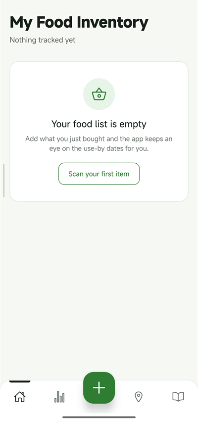
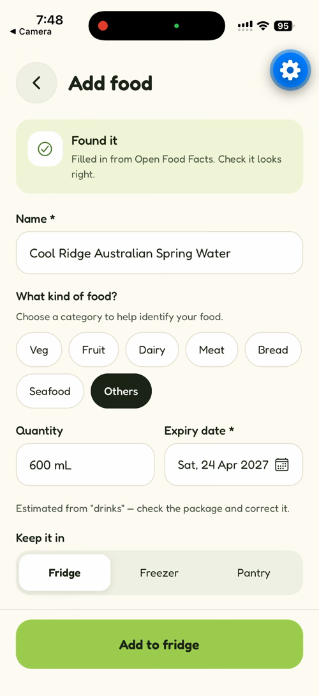
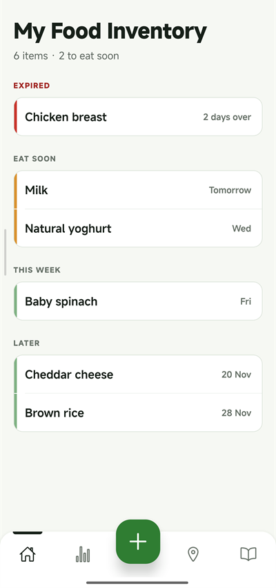
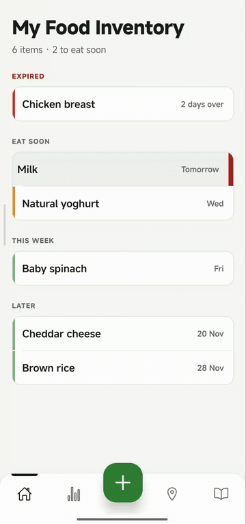
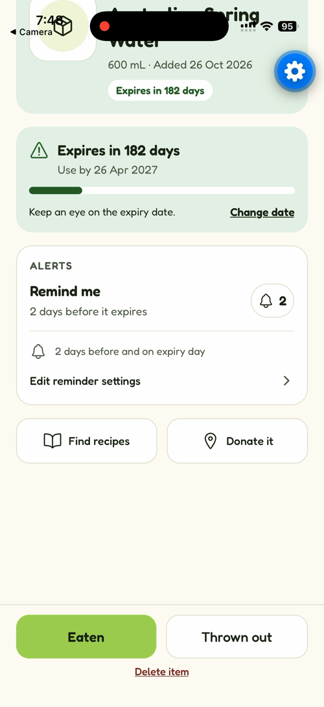
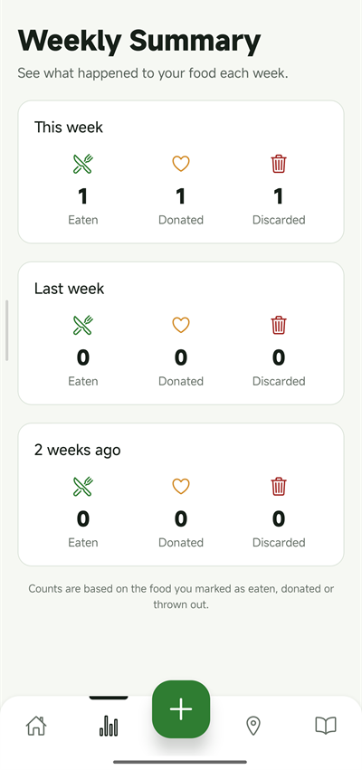
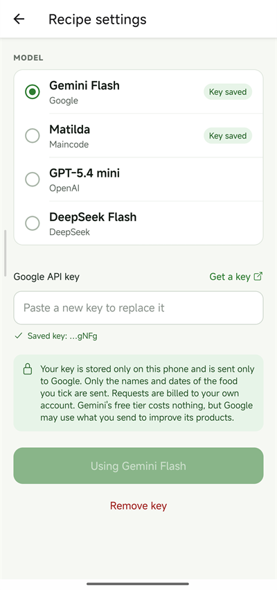

# Smart Food Expiry Tracker: User Guide

Smart Food Expiry Tracker helps you eat the food you buy before it goes off. You add your groceries when you unpack them, and the app keeps an eye on the dates for you. It reminds you before food expires, suggests recipes for what needs using up, and points you to a nearby food bank for anything you can't finish. A weekly summary shows what you ate, donated and threw away.

This guide walks you through the main things you can do, step by step. You don't need an account: everything stays on your phone.

> **Setting up the app for the first time?** Follow [Getting started](../README.md#getting-started) in the main README to open it on your phone with Expo Go, then come back here.

## Contents

1. [The Home screen](#1-the-home-screen)
2. [Add food by scanning its barcode](#2-add-food-by-scanning-its-barcode)
3. [Add food by hand](#3-add-food-by-hand)
4. [See what to eat first](#4-see-what-to-eat-first)
5. [Get reminded before food expires](#5-get-reminded-before-food-expires)
6. [Look at, change or delete an item](#6-look-at-change-or-delete-an-item)
7. [Mark food as eaten, donated or thrown out](#7-mark-food-as-eaten-donated-or-thrown-out)
8. [Check your weekly summary](#8-check-your-weekly-summary)
9. [Find a place to donate food](#9-find-a-place-to-donate-food)
10. [Get recipe ideas for food that needs using up](#10-get-recipe-ideas-for-food-that-needs-using-up)
11. [If something doesn't work](#11-if-something-doesnt-work)

## 1. The Home screen

When you open the app, you land on **My Food Inventory**. The first time, it's empty.

The bar at the bottom takes you around the app:

| Button | What it opens |
| --- | --- |
| **Home** (house) | Your food, grouped by how long it has left |
| **Summary** (chart) | What happened to your food each week |
| Round **+** button in the middle | The barcode scanner, to add food |
| **Donation points** (map pin) | Places near you that take spare food |
| **Recipes** (book) | Recipe ideas for the food you have |

## 2. Add food by scanning its barcode

This is the quickest way to add packaged food.

1. Tap the round **+** button in the middle of the bottom bar, or **Scan your first item** on an empty Home screen.
2. The first time, tap **Allow camera** and let the app use your camera.
3. Point the camera at the barcode on the packet. The app reads it by itself, then shows **Looking this product up...**
4. The **Add grocery item** form opens with the product's name and size filled in. When the app recognises the kind of food, it fills in an estimated expiry date too.
5. **Check the expiry date against the packet.** An estimate is only a guess, and some products get none, so tap **Choose a date** if it's empty. Change anything that's wrong.
6. Tap **Save item**.

If the app doesn't know the product, or you have no internet, the form opens empty with a message saying why. Just fill it in by hand, as in the next section.

## 3. Add food by hand

Use this for loose fruit and vegetables, or anything without a barcode.

1. Tap the round **+** button, then **Type it in instead**.
2. Fill in the form:
   - **Item name** (required), for example "Natural yoghurt".
   - **Quantity** (optional), for example "1 tub" or "500 g". Leave it empty for one item.
   - **Expiry date** (required). Tap **Choose a date**, then pick the date printed on the packet. On iPhone, tap **Done** when you've picked it. On Android, tap **OK**.
   - **Remind me before expiry** (required): how many days before the expiry date you want a reminder, from 1 to 7. It starts at 1.
   - **Notes** (optional), for example "Opened on Monday".
3. Tap **Save item**.

 

## 4. See what to eat first

Back on **Home**, your food is sorted into groups, with the most urgent at the top:

| Group | What's in it |
| --- | --- |
| **Expired** | Food past its expiry date |
| **Eat soon** | Food that expires today or in the next 3 days |
| **This week** | Food that expires within 7 days |
| **Later** | Everything else |

The line under the title tells you how much you have, for example "5 items · 2 to eat soon". Each row shows when the food expires: "Today", "Tomorrow", a weekday, or a date.

**Shortcut:** swipe a row to the left to show **Edit** and **Delete**. Delete always asks you to confirm first.

## 5. Get reminded before food expires

When you save your first item, the app asks if it can send you notifications. Tap **Allow**.

You then get two reminders for each item, both at 9 am:

- one the number of days before expiry that you chose, for example "Use Milk soon";
- one on the expiry day itself, for example "Milk expires today".

Tap a reminder to open that item in the app.

If you said no to notifications, you can turn them on later in your phone's settings. Then open the item, tap **Edit item** and save it again to set its reminders.

## 6. Look at, change or delete an item

Tap any item on Home to open it.

- **Item details** shows the expiry date, which reminders are set, the quantity, the day you added it and any notes. The date added helps you tell apart two of the same product.
- **Edit item** opens the form again, so you can fix a date or a name. Tap **Save changes** when you're done.
- **Delete item** removes it completely. The app asks you to confirm, and you can tap **Keep item** to back out.

## 7. Mark food as eaten, donated or thrown out

When the food is gone, open the item and tap one of these:

- **Mark as eaten**
- **Mark as donated**
- **Mark as thrown out**

The item leaves your Home list, its reminders are cancelled, and it's counted in your weekly summary. Use these instead of **Delete item**: deleting removes the item without counting it.

## 8. Check your weekly summary

Tap **Summary** in the bottom bar to see what happened to your food this week, last week and the week before. Weeks run from Monday to Sunday.

Each week shows how many items you **Eaten**, **Donated** and **Discarded** (threw out). Aim to keep the Discarded number low!

## 9. Find a place to donate food

If you can't finish something in time, someone else might.

1. Open the item and tap **Find donation point**, or tap **Donation points** in the bottom bar.
2. The first time, let the app use your location. The app uses it to sort the list and doesn't upload it to any server.
3. You see food banks, soup kitchens and community pantries within 10 km, closest first, with their address and opening hours.
4. To narrow the list, type in **Search donation points**, for example "pantry".

**Looking somewhere else?** Tap the place name at the top (it has a small arrow), type a suburb and its state, for example "Newtown NSW", and press search on the keyboard. Tap **Use my location** to come back to places near you.

Most places listed are in or near the state capitals. If nothing is close by, try a nearby bigger suburb.

## 10. Get recipe ideas for food that needs using up

The app can ask an AI model for simple recipes that use the food you pick. You need a free key for this once. If you're marking this project, use the test key from our Canvas submission instead.

**Set it up (once):**

1. Tap **Recipes** in the bottom bar, then **Set up**.
2. Under **Model**, keep **Gemini Flash**, which is free.
3. Tap **Get a key** to open Google AI Studio, create a key and copy it.
4. Paste it into the key box and tap **Save and check**. The app checks the key works before saving it. It's kept only in your phone's secure storage.

**Get recipes:**

1. On **Recipes**, look at **Your food**. Food that expires in the next 3 days is already ticked for you. Tick or untick anything, up to 10 items.
2. Tap **Suggest recipes**. After a few seconds, recipe cards appear. Each shows which of your food it uses, what else you need, and the steps.
3. Tap the **star** on a recipe you like to keep it. Tap **Saved recipes** to find it later; tap a saved recipe to open its steps.
4. Not inspired? Tap **Suggest different recipes** for new ideas.

If a recipe uses food that has already expired, the card shows a red warning. Check that food is still safe before cooking with it.

## 11. If something doesn't work

| What happens | What to do |
| --- | --- |
| The scanner shows "Camera access is off" | Turn on the camera for Expo Go in your phone's settings, or tap **Type it in instead** |
| A scanned product isn't found | Add it by hand. The barcode is still saved with the item |
| No reminders arrive | Turn on notifications for Expo Go in your phone's settings, then open the item and save it again from **Edit item** |
| Donation points says location is off | Allow location in your phone's settings, or tap **Search a suburb** |
| "Couldn't reach" or "busy" on Recipes | Check your internet connection and tap **Try again**. Free AI models are sometimes busy for a few seconds |
| "Did not accept this key" in recipe settings | Copy the whole key again and paste it in |

For how the app works inside, or how to build on it, see the [main README](../README.md).
