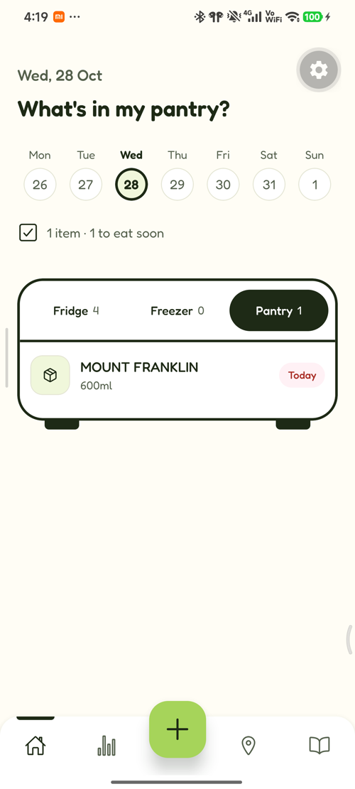
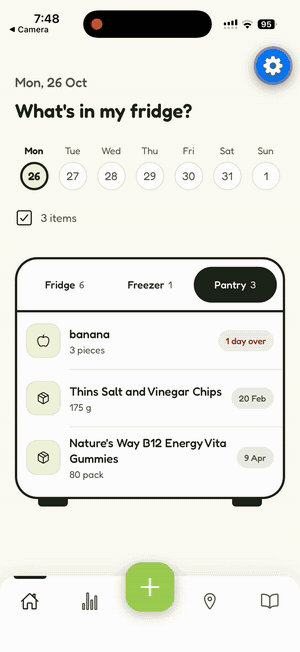
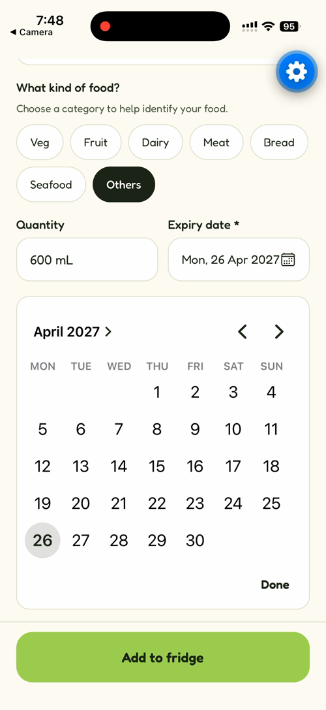
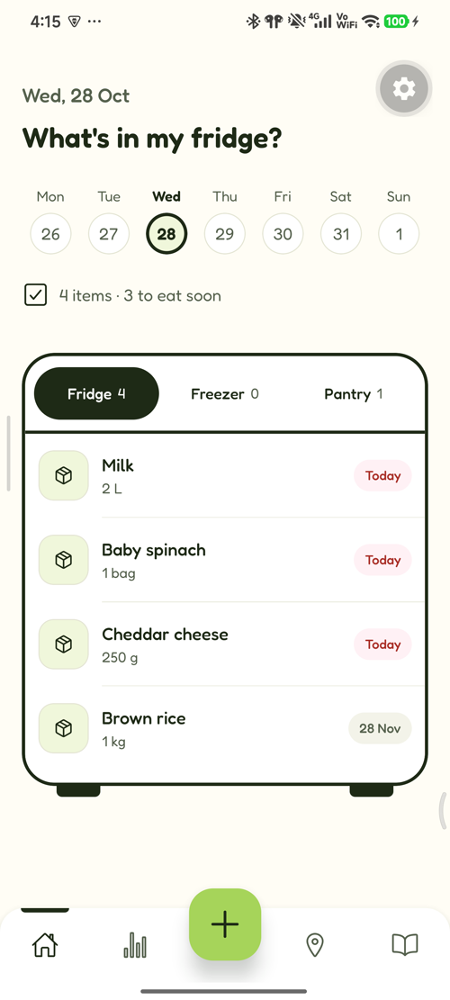
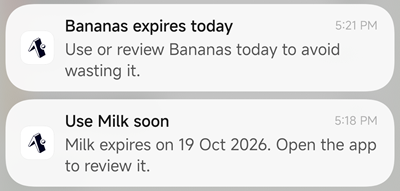
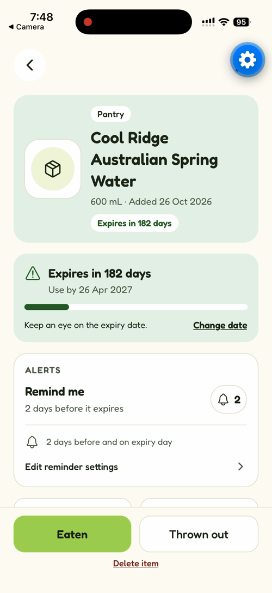
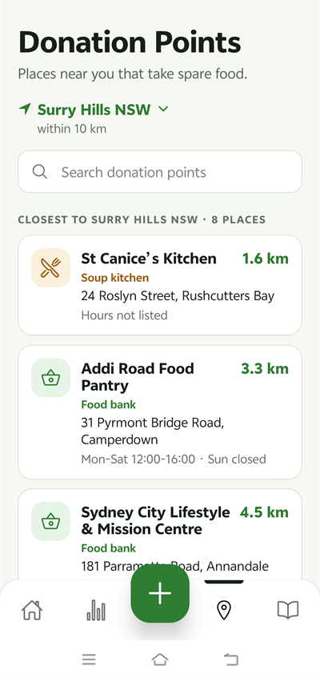
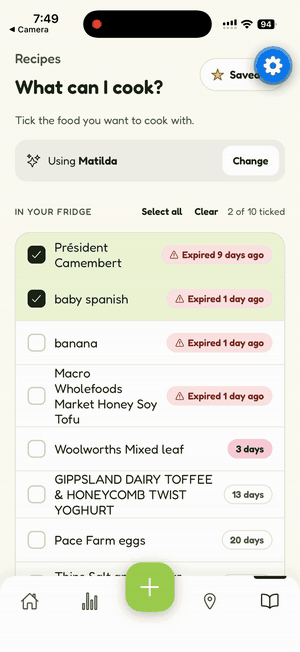

# Smart Food Expiry Tracker: User Guide

Smart Food Expiry Tracker helps you eat the food you buy before it goes off. You add your groceries when you unpack them, and the app keeps an eye on the dates for you. It reminds you before food expires, suggests recipes for what needs using up, and points you to a nearby food bank for anything you can't finish. A summary shows what you ate, donated and threw away.

This guide walks you through the main things you can do, step by step. You don't need an account: everything stays on your phone.

> **Setting up the app for the first time?** Follow [Getting started](../README.md#getting-started) in the main README to open it on your phone with Expo Go, then come back here.

## Contents

1. [The Home screen](#1-the-home-screen)
2. [Add food by scanning its barcode](#2-add-food-by-scanning-its-barcode)
3. [Add food by hand](#3-add-food-by-hand)
4. [See what to eat first](#4-see-what-to-eat-first)
5. [Get reminded before food expires](#5-get-reminded-before-food-expires)
6. [Look at, change or delete an item](#6-look-at-change-or-delete-an-item)
7. [Mark food as eaten or thrown out](#7-mark-food-as-eaten-or-thrown-out)
8. [Check your waste summary](#8-check-your-waste-summary)
9. [Donate food you can't finish](#9-donate-food-you-cant-finish)
10. [Get recipe ideas for food that needs using up](#10-get-recipe-ideas-for-food-that-needs-using-up)
11. [If something doesn't work](#11-if-something-doesnt-work)

## 1. The Home screen

When you open the app, you land on **What's in my fridge?**. Under the title are three tabs, **Fridge**, **Freezer** and **Pantry**, each showing how many items it holds. The first time, they're empty.

The bar at the bottom takes you around the app:

| Button | What it opens |
| --- | --- |
| **Home** (house) | Your food, in the Fridge, Freezer and Pantry tabs |
| **Summary** (chart) | What happened to your food this week or this month |
| Round **+** button in the middle | The barcode scanner, to add food |
| **Donation points** (map pin) | Places near you that take spare food |
| **Recipes** (book) | Recipe ideas for the food you have |

## 2. Add food by scanning its barcode

This is the quickest way to add packaged food.

1. Tap the round **+** button in the middle of the bottom bar, or **Scan a food item** on an empty Home screen.
2. The first time, tap **Allow camera** and let the app use your camera.
3. Hold the barcode inside the frame. The app reads it by itself, then shows **Looking up your food...**
4. The **Add food** form opens with the product's name, size and kind of food filled in, and a message saying it was found. When the app recognises the kind of food, it fills in an estimated expiry date too.
5. **Check the expiry date against the packet.** An estimate is only a guess, and some products get none, so tap **Choose a date** if it's empty. Change anything that's wrong.
6. Under **Keep it in**, choose **Fridge**, **Freezer** or **Pantry**.
7. Tap **Add to fridge** (or freezer, or pantry).

If the app doesn't know the product, or you have no internet, the form opens empty with a message saying why. Just fill it in by hand, as in the next section.

## 3. Add food by hand

Use this for loose fruit and vegetables, or anything without a barcode.

1. Tap the round **+** button, then **Type it in instead**.
2. Fill in the form:
   - **Name** (required), for example "Natural yoghurt".
   - **What kind of food?**: tap Veg, Fruit, Dairy, Meat, Bread, Seafood or Others. It sets the item's icon.
   - **Quantity** (optional), for example "1 tub" or "500 g". Leave it empty for one item.
   - **Expiry date** (required). Tap **Choose a date**, then pick the date printed on the packet. On iPhone, tap **Done** when you've picked it.
   - **Keep it in**: Fridge, Freezer or Pantry.
   - **Expiry reminder**: how many days before the expiry date you want a reminder. Tap **-** and **+** to choose from 1 to 7. It starts at 1.
   - **Notes** (optional), for example "Opened on Monday".
3. Tap **Add to fridge** (or freezer, or pantry).

 

## 4. See what to eat first

Back on **Home**, tap **Fridge**, **Freezer** or **Pantry** to see what's in each. The food that expires soonest is always at the top.

The line under the title tells you how much is there, for example "5 items · 2 to eat soon". Each row has a coloured badge for how urgent it is:

| Badge | Means |
| --- | --- |
| Red | Expired, or expires within 3 days |
| Amber | Expires within a week |
| Grey | Expires later |

The row also says when it expires: "Today", "Tomorrow", a weekday, a date, or "2 days over" for food that has already expired.

**Shortcut:** swipe a row to the left to show **Edit** and **Delete**. Delete always asks you to confirm first.

## 5. Get reminded before food expires

When you save your first item, the app asks if it can send you notifications. Tap **Allow**.

You then get two reminders for each item, at 9 am:

- one the number of days before expiry that you chose, for example "Use Milk soon";
- one on the expiry day itself, for example "Milk expires today".

If 9 am on the first reminder's day has already passed when you save the item, that reminder comes a minute after you save instead. Food you add on its expiry day gets only the expiry-day reminder.

Tap a reminder to open that item in the app.

If you said no to notifications, you can turn them on later in your phone's settings. Then open the item, tap **Edit reminder settings** and tap **Save changes** to set its reminders. The item's **Reminders** card always says which reminders are actually set.

## 6. Look at, change or delete an item

Tap any item on Home to open it. Its screen shows:

- where it's kept, its quantity and the day you added it. The date added helps you tell apart two of the same product;
- when it expires, with **Change date** to correct it;
- **Reminders**: which reminders are set, with **Edit reminder settings** to change the number of days;
- any notes.

To change anything else, tap the pencil at the top right. The same form as **Add food** opens. Tap **Save changes** when you're done.

To remove an item completely, tap **Delete item** at the bottom. The app asks you to confirm with **Delete**, and you can tap **Keep item** to back out.

## 7. Mark food as eaten or thrown out

When the food is gone, open the item and tap one of the two buttons at the bottom:

- **Eaten**
- **Thrown out**

The item leaves your Home list, its reminders are cancelled, and it's counted in your summary. Use these instead of **Delete item**: deleting removes the item without counting it.

Food you give away is marked as donated from the donation point's page instead (see [section 9](#9-donate-food-you-cant-finish)). A recipe can also mark the food it used (see [section 10](#10-get-recipe-ideas-for-food-that-needs-using-up)).

Marked something as thrown out by mistake? Open it from the **Thrown out** list on **Summary** and tap **Delete item**. That takes it out of the summary too.

## 8. Check your waste summary

Tap **Summary** in the bottom bar to see your **Waste summary**. Tap **Week** or **Month** at the top to choose the period. Weeks run from Monday to Sunday.

- The big number says how many of your items were saved, meaning eaten or donated, out of all the food you marked.
- Below it are the counts for **Eaten**, **Donated** and **Thrown out**. Aim to keep the thrown-out number low!
- In the week view, **Day by day** shows a bar for each day.
- **Thrown out** lists the food you threw away, newest first. Tap one to open it. If there are more than ten, tap **Show 2 more** (or however many there are) to see the rest.

## 9. Donate food you can't finish

If you can't finish something in time, someone else might.

1. Open the item and tap **Donate it**, or tap **Donation points** in the bottom bar. (Food that has already expired has no **Donate it**: donation points can't take it.)
2. The first time, let the app use your location. It's used to sort the list and to name your suburb.
3. You see food banks, soup kitchens and community pantries within 10 km, closest first, with their address and opening hours.
4. To narrow the list, type in **Search donation points**, for example "pantry".
5. Tap a place to open its page. It shows whether it's open now, its hours for the week, and **Directions** to it in your maps app.
6. Under **Food to bring**, tick the food you're taking. All your food that's still in date is listed, soonest expiry first.
7. Once you've handed it over, tap **Mark 1 item as donated** (or however many you ticked). The food leaves Home and counts as donated in your summary. Tap **Done**.

**Looking somewhere else?** Tap the place name at the top, type a suburb, and tap it in the list of suggestions. Tap **Use my current location** to come back to places near you.

Most places listed are in or near the state capitals. If nothing is close by, try a nearby bigger suburb. The list doesn't say what each place accepts, so check with the place before bringing fresh or chilled food.

## 10. Get recipe ideas for food that needs using up

The app can ask an AI model for simple recipes that use the food you pick. You need a free key for this once. If you're marking this project, use the test key from our Canvas submission instead.

**Set it up (once):**

1. Tap **Recipes** in the bottom bar, then **Set up**.
2. Under **Model**, keep **Gemini Flash**, which is free.
3. Tap **Get a key** to open Google AI Studio, create a key and copy it.
4. Paste it into the key box and tap **Save and check**. The app checks the key works before saving it. It's kept only in your phone's secure storage.

**Get recipes:**

1. On **Recipes** (**What can I cook?**), look at **In your fridge**. It lists all your food, wherever it's kept. Food that expires in the next 3 days is already ticked for you. Tick or untick anything, up to 10 items, or tap **Select all**.
2. Tap **Suggest recipes**. After a few seconds, recipe cards appear, each with its time and the food it uses.
3. Tap a card to open the recipe. It shows the food it uses from your fridge, what else you'll need, and the steps.
4. Tap the **star** on a recipe you like to keep it. Tap **Saved** at the top of the Recipes tab to find it later.
5. Not inspired? Tap **More ideas** for new ones.
6. Cooked it? On the recipe's page, tap **Mark as consumed** to mark the food it used as eaten, or **Mark as wasted** if it went in the bin. The app asks you to confirm first, because the whole item is marked, not just what the recipe used. Both count in your summary.

If a recipe uses food that has already expired, it shows a red warning. Check that food is still safe before cooking with it.

## 11. If something doesn't work

| What happens | What to do |
| --- | --- |
| The scanner shows "Camera access is off" | Turn on the camera for Expo Go in your phone's settings, or tap **Type it in instead** |
| A scanned product isn't found | Add it by hand. The barcode is still saved with the item |
| No reminders arrive | Turn on notifications for Expo Go in your phone's settings, then open the item, tap **Edit reminder settings** and **Save changes** |
| Donation points says location is off | Allow location in your phone's settings, or tap **Search a suburb** |
| Food marked as thrown out by mistake | Open it from the **Thrown out** list on **Summary** and tap **Delete item** |
| "Couldn't reach" or "busy" on Recipes | Check your internet connection and tap **Try again**. Free AI models are sometimes busy for a few seconds |
| "Google did not accept this key" in recipe settings | Copy the whole key again and paste it in |

For how the app works inside, or how to build on it, see the [main README](../README.md).
